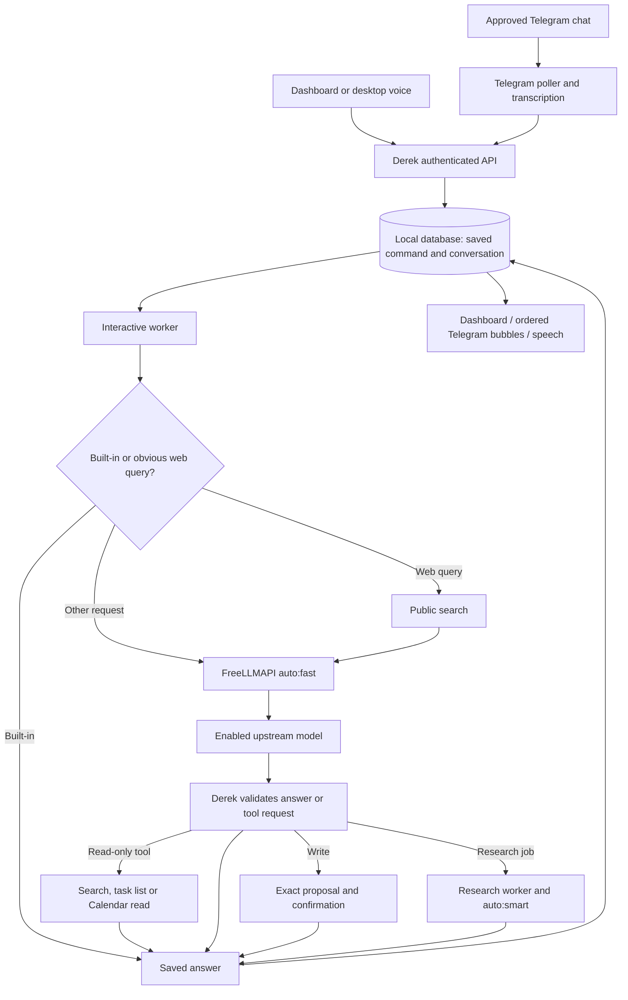

# Derek: model roles, context, communication and storage

Updated: **2026-10-20 · Asia/Kolkata**

## 1. Current model roles

| Work | Selection | What the model does |
|---|---|---|
| Dashboard chat, Telegram text/voice-note replies, online desktop voice | FreeLLMAPI `auto:fast` | Answer questions or propose registered tool calls |
| Current facts and recommendations | Public search, then `auto:fast` | Summarize actual search snippets and cite returned sources |
| Research queries, evidence judgments, five project ideas, two shortlisted ideas and report-summary selection | FreeLLMAPI `auto:smart` | Return the JSON required by each versioned task template |
| Exact greetings, help, time/date, status and task listing | Derek's built-in handlers | Answer supported exact requests without model inference |
| Reminder/Calendar approval and execution | Derek's Python services/database | Validate, generate exact readback, wait for confirmation and execute; the model cannot approve its own action |
| Approved browser/file workflows | Windows companion | Execute reviewed tools within approved domains/folders |
| Private desktop text/voice chat | Local Ollama `qwen3:4b` | Separate local conversation with no account, internet or scheduling tools |
| Voice recognition | Local faster-whisper | Convert audio into text |
| Online speech output | Existing Cartesia configuration | Speak Derek's final reply; separate from the chat model |
| Private speech output | Installed Windows voice | Speak locally |

`auto:fast` and `auto:smart` are routing strategies, not fixed models. They select from the providers/models enabled in your FreeLLMAPI installation. Derek does not enable paid providers, add provider keys, or silently fall back to another inference service. FreeLLMAPI's own routing/fallback policy still applies. Different calls may use different models. Restrict its enabled pool or set an exact model ID if you want a fixed destination.

Current configuration, with the key omitted:

```dotenv
MODEL_PROVIDER=freellmapi
FREELLMAPI_BASE_URL=http://127.0.0.1:3001/v1
FREELLMAPI_MODEL=auto:fast
FREELLMAPI_RESEARCH_MODEL=auto:smart
FREELLMAPI_REASONING_EFFORT=none
```

The reasoning hint prevents supported providers from consuming short reply budgets with hidden reasoning. Blank omits the hint; provider support differs. `auto:smart` selects by capability ranking, but is not a guarantee of correctness, depth or speed. Chat and research model roles are shown in dashboard Settings → Connections.

## 2. How a request travels



The diagram's confirmation node does not execute a write by itself: the owner must confirm the exact pending proposal through its bound control before server validation and execution. Browser/file workflows have their separate reviewed scopes and checkpoints.

HTTP/JSON connects Derek to FreeLLMAPI. The selected model returns text or typed tool-call arguments. Derek validates those arguments and alone dispatches tools. Search-only answer synthesis receives no callable tools. Research runs through a separate worker so a report does not occupy the interactive worker; all local workers still share the laptop and database. Telegram replies use durable ordered delivery records with throttling and uncertain-send protection.

The application and database remain on the laptop even when the model is hosted remotely. The laptop and the port-3001 router must remain running and connected for Telegram and local schedules. Hosted inference does not make Derek available while the laptop sleeps. This port-3001 router is owner-managed; the optional portable-app launcher only applies to the separate known port-31415 installation.

## 3. What context a model receives

For each ordinary turn Derek constructs a fresh request from:

1. The common versioned identity, task/permission rules and final-answer policy.
2. Current local date/time, timezone, available capabilities and their status.
3. Channel style: dashboard detail, concise Telegram paragraphs or brief desktop speech.
4. A recent window from **that conversation**: at most **16 user/assistant messages**, including the current request, with a **20,000-character history budget**. Historical tool dumps and memory-management messages are excluded. Older long messages are explicitly abridged while preserving their start/end, so one long answer no longer immediately cuts off older turns; the current request is never silently truncated and can exceed that budget by itself.
5. When needed, current tool/search data. Search synthesis bounds each tool result to 6,000 characters and labels it as untrusted evidence.

These limits count characters, not tokens, and do not include all system/tool-schema overhead. Full saved history can be longer than the window sent to inference. Shared long-term memory now adds up to five relevant accepted facts, within 1,800 serialized characters, using local indexed keyword lookup and pinned profile facts. It adds no separate model call. Use Remember label: detail or Settings → Memory to save/correct/forget facts. Ordinary/historical profile statements are suggestions until accepted. There is no semantic/vector search over every past chat or hidden all-history summary. Saved recent context and selected memory facts are sent again when a provider changes; no model's private memory is transferred. See [MEMORY.md](MEMORY.md).

Background research receives its specific topic, bounded evidence, recent project-title exclusions and the required JSON schema; it does not receive every personal chat. Research instructions and server checks are shared across providers. See [PROMPT_TEMPLATES.md](PROMPT_TEMPLATES.md).

Telegram keeps a persistent channel conversation associated with the approved chat. Dashboard conversations and desktop online voice use their selected/saved conversation IDs. They share the owner's tasks, workflows, reports and settings, but **do not automatically merge all their conversation transcripts**. Private desktop chat is a separate store and is never added to normal cloud-model context.

This is context management, not training or fine-tuning the model on your chats.

Answer detail is now adaptive, with a shared `/style auto|brief|balanced|detailed` preference and larger bounded answer budgets. Ordinary questions omit large write schemas. Conversation adapters now share operational inspection/control handlers and exact confirmations for workflow, run, report and global controls. See [MODEL_USAGE_AND_CONTROLS.md](MODEL_USAGE_AND_CONTROLS.md) for controls, limits and the remaining dashboard-only features.

## 4. Where chats and related data are stored

| Data | Current local location / representation |
|---|---|
| Normal chats, Telegram conversation sessions, commands, actions, proposals, task schedules, audit records and delivery states | `C:\Users\NAGARAM KRIDEY\Desktop\Lily-Leo\backend\db.sqlite3` (SQLite with WAL) |
| Chat content | `Conversation` + `Message`: role, text, timestamp and metadata |
| Request lifecycle | `Command`, events and actions: request ID, status, saved response, errors, timings and approval binding |
| Inference trace | Saved answer metadata includes requested/served model and router provider when returned; `model.routed` audit records also identify routed research operations |
| Report PDF/DOCX files | `C:\Users\NAGARAM KRIDEY\Desktop\Lily-Leo\backend\media\reports\` |
| Private local chat | `C:\Users\NAGARAM KRIDEY\AppData\Local\LilyLeo\private\history.sqlite3` |
| Derek runtime logs, snapshots and local operational state | Project `.companion` folder; normal-database snapshots in `.companion\backups` |
| Provider/router configuration | Ignored project `.env`; the FreeLLMAPI unified key is here |
| Desktop online owner-session credential | Windows Credential Manager; separate from provider keys |

Normal and private SQLite history are **not encrypted databases**. Local file access controls protect the live files. Daily database snapshots are encrypted when a valid configured key is present; some startup/pre-migration snapshots can be plaintext. Backups cover the normal database, not report attachments or the separate private history, and are local rather than off-device recovery. Chat/task history remains until deleted using available app controls; normal owner export and private export are separate.

The ignored files are not committed to GitHub. Browser session cookies remain in the companion's separate local browser profile. Telegram itself holds the messages sent through Telegram. FreeLLMAPI and its upstream providers have separate logging/retention policies; storing Derek's history locally does not prevent those services from processing the context sent to them. Turning off the browser tab does not stop the tray runtime; stopping Derek or sleeping the laptop does.

## 5. Observed routing checks

Owner-authorized checks on 2026-10-20:

- Port 3001 authenticated model listing: HTTP 200.
- Direct short routed response after the reasoning adjustment: approximately 3.1 seconds.
- Derek general answer: 3.0 seconds, routed through Kilo to a Dots model.
- Derek public search and cited answer: 8.1 seconds, six citations, routed through Google.
- Reminder proposal: 3.0 seconds. Exact readback was generated; proposal cancelled, **zero test reminder tasks created**.
- Telegram-style preview: 3.2 seconds, three bubbles of 171, 195 and 186 characters; no Telegram message was sent.
- Structured research-plan check through `auto:smart`: valid JSON queries; observed route `groq/qwen/qwen3.8-27b`.
- Regression: **124 Python tests and eight dashboard tests passed**. Dashboard production build and selected Ruff checks passed.

These are individual observations across different prompts/models, not guaranteed latency or a controlled before/after benchmark. A full new report, incoming Telegram exchange, microphone/speech and overnight operation were not exercised by these routing checks.
