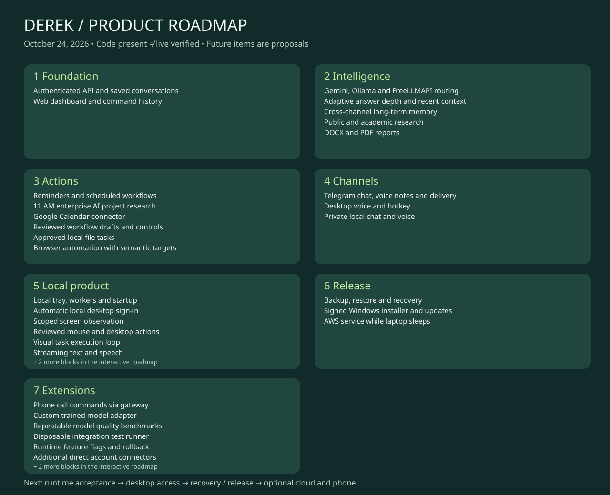

# Derek — complete product roadmap

Snapshot: 2026-10-24. This inventory consolidates the original plan and later requests. Implemented means code exists; verified requires recorded acceptance evidence. Historical checklist entries describe their date, not necessarily current configuration.

## How to use the live board

Open **Roadmap** in Derek. Changes are owner-scoped and saved in the application database. The board starts from this catalog once; later catalog edits never overwrite your custom board. Use Save changes, then Export JSON for a portable copy or Copy prompt to hand a feature to Codex. Unsaved edits are marked. Stale saves are rejected.

Planning enabled/disabled controls inclusion in generated prompts. Test mode and Queue test plan record intentions only. They do not run commands, activate features, or grant permissions. Verified/passed requires evidence. Runtime feature switches and an isolated execution runner are separate future blocks.

Additional controls: search/status filters, dependency validation, priority selection, evidence/results tracking, duplicate blocks, archive-by-disabling, JSON export and printable visual roadmap. No automatic prompt execution. Do not put credentials in roadmap notes.

## Delivery order

1. Fix runtime health and accept existing model/channel controls.
2. Accept memory, scheduling and scoped browser/file flows.
3. Add secure desktop auto sign-in, observation, then reviewed mouse actions.
4. Add streaming, recovery drills and signed packaging.
5. Provision optional cloud/phone only after account, cost and transport decisions.
6. Evaluate extensions against real usage before committing.

## Inventory and actionable checklist

### Authenticated API and saved conversations · foundation

- Phase: 1 Foundation · Origin: Original
- Status: **implemented** · Difficulty: **medium**
- Scope: Django/DRF, owner authentication, durable commands, audit and export/delete controls.
- [ ] Next acceptance/work: Verify retention and owner isolation after each schema change.
- Your part: Keep the account credentials private.
- Dependencies: None specified

### Web dashboard and command history · dashboard

- Phase: 1 Foundation · Origin: Original
- Status: **implemented** · Difficulty: **medium**
- Scope: Chat, Today, Activity, Reports, Automations, Features and Settings.
- [ ] Next acceptance/work: Live browser acceptance of current controls.
- Your part: Use the dashboard and report usability issues.
- Dependencies: foundation

### Gemini, Ollama and FreeLLMAPI routing · models

- Phase: 2 Intelligence · Origin: Expanded later
- Status: **implemented** · Difficulty: **high**
- Scope: Shared templates and typed tools; fast chat and smart research routes; provider/usage records.
- [ ] Next acceptance/work: Benchmark actual replies, tools and structured output on active routes.
- Your part: Keep the selected router available; configure provider credentials locally.
- Dependencies: None specified

### Adaptive answer depth and recent context · context

- Phase: 2 Intelligence · Origin: Expanded later
- Status: **in_progress** · Difficulty: **medium**
- Scope: Up to 16 messages and 20,000 characters; explicit depth preference; bounded Telegram bubbles.
- [ ] Next acceptance/work: Live multi-turn relevance and detailed reply acceptance across channels.
- Your part: Choose preferred answer depth.
- Dependencies: models

### Cross-channel long-term memory · memory

- Phase: 2 Intelligence · Origin: Expanded later
- Status: **implemented** · Difficulty: **high**
- Scope: Owner-scoped accepted facts, suggestions, correction, forgetting, pinning and bounded local retrieval.
- [ ] Next acceptance/work: Verify correction, forgetting and isolation across real channels.
- Your part: Review suggestions and remove unwanted facts.
- Dependencies: foundation

### Public and academic research · research

- Phase: 2 Intelligence · Origin: Original
- Status: **implemented** · Difficulty: **high**
- Scope: Web search, Semantic Scholar, evidence review and citations; unsupported claims labeled.
- [ ] Next acceptance/work: Accept end-to-end research accuracy and unavailable-source behavior.
- Your part: Select useful research topics.
- Dependencies: None specified

### DOCX and PDF reports · reports

- Phase: 2 Intelligence · Origin: Original
- Status: **implemented** · Difficulty: **medium**
- Scope: Report library, progress, cancellation, downloads and queued Telegram copies.
- [ ] Next acceptance/work: Accept current smart route report generation and delivery.
- Your part: Review report usefulness.
- Dependencies: research

### Reminders and scheduled workflows · schedule

- Phase: 3 Actions · Origin: Original
- Status: **implemented** · Difficulty: **high**
- Scope: Once/daily/weekly scheduling, Asia/Kolkata defaults, durable dispatch and exact proposals.
- [ ] Next acceptance/work: Live microphone confirmation and overnight retry/reboot acceptance.
- Your part: Keep laptop awake until a cloud runner exists.
- Dependencies: None specified

### 11 AM enterprise AI project research · daily-projects

- Phase: 3 Actions · Origin: Requested later
- Status: **implemented** · Difficulty: **medium**
- Scope: Daily five project ideas, shortlist two and produce a report; historical delivery evidence exists.
- [ ] Next acceptance/work: Inspect next scheduled run and quality with current routing.
- Your part: Refine company interests and project criteria.
- Dependencies: schedule, reports

### Google Calendar connector · calendar

- Phase: 3 Actions · Origin: Original
- Status: **blocked** · Difficulty: **medium**
- Scope: OAuth calendar read/create/update; deletion not exposed.
- [ ] Next acceptance/work: Complete OAuth and live read/create/update acceptance.
- Your part: Supply OAuth client settings and consent.
- Dependencies: None specified

### Reviewed workflow drafts and controls · workflows

- Phase: 3 Actions · Origin: Original
- Status: **implemented** · Difficulty: **high**
- Scope: Allowed tools/sites/folders, exact approvals, pause/resume, edits disable prior review.
- [ ] Next acceptance/work: Test stale approvals, global pause and cross-channel replay on current code.
- Your part: Review exact scopes before activation.
- Dependencies: None specified

### Approved local file tasks · files

- Phase: 3 Actions · Origin: Original
- Status: **implemented** · Difficulty: **medium**
- Scope: Local companion restricts operations to approved folders; no arbitrary shell.
- [ ] Next acceptance/work: Accept file actions in a disposable approved folder.
- Your part: Choose allowed folders.
- Dependencies: None specified

### Browser automation with semantic targets · browser

- Phase: 3 Actions · Origin: Original
- Status: **implemented** · Difficulty: **high**
- Scope: Dedicated Playwright profile; navigation/read/fill/click/select/wait/scroll with scope and challenge gates.
- [ ] Next acceptance/work: Accept signed-in real workflows; fixture and public read checks already passed.
- Your part: Manual sign-in, MFA/CAPTCHA and domain approval.
- Dependencies: None specified

### Telegram chat, voice notes and delivery · telegram

- Phase: 4 Channels · Origin: Original
- Status: **implemented** · Difficulty: **high**
- Scope: Approved owner chat, ordered short bubbles, confirmations, reminders and reports.
- [ ] Next acceptance/work: Real incoming/outgoing detailed replies and signed confirmation acceptance.
- Your part: Keep bot/chat configuration valid.
- Dependencies: None specified

### Desktop voice and hotkey · voice

- Phase: 4 Channels · Origin: Original
- Status: **implemented** · Difficulty: **high**
- Scope: Whisper, speech output, native voice window, readback confirmation and interruption.
- [ ] Next acceptance/work: Real microphone/playback/confirmation acceptance; simulated persistence path passed.
- Your part: Choose audio devices and try a harmless reminder.
- Dependencies: None specified

### Private local chat and voice · private

- Phase: 4 Channels · Origin: Expanded later
- Status: **implemented** · Difficulty: **medium**
- Scope: Separate local Ollama conversation store with no cloud tools or scheduling.
- [ ] Next acceptance/work: Verify private history stays outside shared memory/export.
- Your part: Keep a local model available.
- Dependencies: None specified

### Local tray, workers and startup · runtime

- Phase: 5 Local product · Origin: Expanded later
- Status: **in_progress** · Difficulty: **high**
- Scope: Managed processes, durable local worker lanes, desktop shortcut and sign-in startup enabled on October 23.
- [ ] Next acceptance/work: Resolve supervisor needs_attention and test real reboot recovery.
- Your part: Allow startup and keep project/virtual environment in place.
- Dependencies: None specified

### Automatic local desktop sign-in · autologin

- Phase: 5 Local product · Origin: Requested later
- Status: **in_progress** · Difficulty: **high**
- Scope: Use Windows-protected credentials and a short-lived desktop launch exchange; website retains authentication.
- [ ] Next acceptance/work: Design origin/replay protections and verify logout/revocation.
- Your part: One initial owner sign-in may still be required.
- Dependencies: foundation, runtime

### Scoped screen observation · observe

- Phase: 5 Local product · Origin: Requested later
- Status: **in_progress** · Difficulty: **high**
- Scope: Window and UI Automation observation with password redaction, foreground scope and local permission.
- [ ] Next acceptance/work: Implement observation adapter and disposable application fixture.
- Your part: Choose approved apps and grant a local session.
- Dependencies: None specified

### Reviewed mouse and desktop actions · mouse

- Phase: 5 Local product · Origin: Requested later
- Status: **planned** · Difficulty: **very_high**
- Scope: Fresh screen/window binding, bounded click/type actions, stop control and stale-screen rejection.
- [ ] Next acceptance/work: Build only after observation; test focus changes, lock screen and interruption.
- Your part: Approve app scope; sensitive operations keep confirmation.
- Dependencies: observe, workflows

### Visual task execution loop · visual-agent

- Phase: 5 Local product · Origin: Future extension
- Status: **idea** · Difficulty: **very_high**
- Scope: Optional screenshot model with observe/plan/act/verify steps and strict step limits.
- [ ] Next acceptance/work: Evaluate reliability, privacy, DPI/multiple monitors and cost.
- Your part: Opt in to screenshot processing and choose providers.
- Dependencies: mouse, models

### Streaming text and speech · streaming

- Phase: 5 Local product · Origin: Expanded later
- Status: **planned** · Difficulty: **high**
- Scope: Incremental responses with cancellation and sentence-aware speech transport.
- [ ] Next acceptance/work: Preserve approval readbacks and avoid speaking unvalidated actions.
- Your part: Choose acceptable speech/latency trade-offs.
- Dependencies: None specified

### Optional wake word · wakeword

- Phase: 5 Local product · Origin: Expanded later
- Status: **planned** · Difficulty: **high**
- Scope: Visible microphone state, local wake detection and reliable mute.
- [ ] Next acceptance/work: Measure false wakes and background resource use.
- Your part: Explicit microphone opt-in.
- Dependencies: None specified

### Backup, restore and recovery · backup

- Phase: 6 Release · Origin: Original
- Status: **in_progress** · Difficulty: **high**
- Scope: Local snapshots and encrypted DB backups exist; reports/private history need complete recovery coverage.
- [ ] Next acceptance/work: Perform restore drill plus sleep/crash/reboot checks.
- Your part: Choose off-device backup destination if desired.
- Dependencies: None specified

### Signed Windows installer and updates · installer

- Phase: 6 Release · Origin: Expanded later
- Status: **planned** · Difficulty: **high**
- Scope: Standalone packaging and reversible schema/update strategy.
- [ ] Next acceptance/work: Test clean install, upgrade, rollback and uninstall.
- Your part: Signing identity/budget decision later.
- Dependencies: runtime, backup

### AWS service while laptop sleeps · cloud

- Phase: 6 Release · Origin: Original
- Status: **blocked** · Difficulty: **high**
- Scope: Terraform for EC2/RDS/Redis/S3/secrets; local runtime remains current deployment.
- [ ] Next acceptance/work: Provision HTTPS, budgets, monitoring and single scheduler/Telegram receiver cutover.
- Your part: AWS access, domain and hosting budget.
- Dependencies: backup

### Phone call commands via gateway · phone

- Phase: 7 Extensions · Origin: Requested later
- Status: **blocked** · Difficulty: **very_high**
- Scope: Samsung A32 4G with Airtel; gateway/forwarding route and short spoken command adapter planned.
- [ ] Next acceptance/work: Establish supported routing, caller verification, latency and costs before provisioning.
- Your part: Confirm Airtel forwarding and gateway eligibility; no route configured.
- Dependencies: voice, workflows

### Custom trained model adapter · custom-model

- Phase: 7 Extensions · Origin: Separate project
- Status: **idea** · Difficulty: **very_high**
- Scope: Compatible inference adapter and evaluations; training is a separate project.
- [ ] Next acceptance/work: Define licensed training data, compute budget and task benchmarks first.
- Your part: Provide model endpoint once available.
- Dependencies: None specified

### Editable roadmap control center · roadmap

- Phase: 5 Local product · Origin: Requested now
- Status: **in_progress** · Difficulty: **medium**
- Scope: Persistent owner board, dependency checks, priorities, evidence, test plans and exportable prompts.
- [ ] Next acceptance/work: Run API regression/build and inspect live page.
- Your part: Add feature requests and evidence; export prompts for Codex.
- Dependencies: None specified

### Repeatable model quality benchmarks · evals

- Phase: 7 Extensions · Origin: Suggested
- Status: **idea** · Difficulty: **medium**
- Scope: Fixture prompts scored for grounding, tool correctness, continuity, latency and cost.
- [ ] Next acceptance/work: Start offline; explicit opt-in for hosted benchmark costs.
- Your part: Choose representative real tasks.
- Dependencies: None specified

### Disposable integration test runner · sandbox

- Phase: 7 Extensions · Origin: Suggested
- Status: **idea** · Difficulty: **high**
- Scope: Execute registered test recipes in separate DB/browser/file fixtures with redacted artifacts.
- [ ] Next acceptance/work: Design isolation; roadmap currently records plans only and never launches tests.
- Your part: Review any external integration test effects.
- Dependencies: roadmap

### Runtime feature flags and rollback · flags

- Phase: 7 Extensions · Origin: Suggested
- Status: **idea** · Difficulty: **high**
- Scope: Server-enforced capability switches, dependency handling and rollback snapshots.
- [ ] Next acceptance/work: Keep planning toggles separate until enforcement is implemented and tested.
- Your part: Review operational disable/enable effects.
- Dependencies: workflows

### Additional direct account connectors · connectors

- Phase: 7 Extensions · Origin: Suggested
- Status: **idea** · Difficulty: **high**
- Scope: Email, notes and document adapters with narrow consent and exact action reviews.
- [ ] Next acceptance/work: Prioritize one connector and test OAuth/token revocation.
- Your part: Choose service and provide consent.
- Dependencies: None specified

### Native mobile companion · mobile

- Phase: 7 Extensions · Origin: Outside v1
- Status: **idea** · Difficulty: **high**
- Scope: Mobile notifications and voice with consistent command/approval protocol.
- [ ] Next acceptance/work: Prove shared protocol first; mobile background limits need design.
- Your part: Choose Android/iOS priorities.
- Dependencies: None specified

### Multi-user and shared workspaces · multiuser

- Phase: 7 Extensions · Origin: Outside v1
- Status: **idea** · Difficulty: **very_high**
- Scope: Tenant isolation, roles, ownership and per-user credentials.
- [ ] Next acceptance/work: Requires a dedicated architecture and security project.
- Your part: Decide whether this belongs in a personal assistant.
- Dependencies: None specified

## Hardest parts and practical limits

- Desktop control: focus changes, inaccessible UI, elevated windows, DPI and nondeterministic pages require observation freshness and fail-closed action checks. Full arbitrary application coverage is not a realistic acceptance promise.
- Phone: a usable SIM alone does not expose call audio to a server; routing, gateway support, identity verification and latency remain unresolved.
- Local speed: model size, available RAM and CPU/GPU determine latency; a router does not make a slow underlying model faster.
- Always on: sign-in startup does not execute while the laptop is asleep or powered off. Cloud availability still needs deployment.
- Custom training: data quality, licensing, compute and regression evaluation make this a separate substantial project.
- Isolation and feature switches: planning metadata is intentionally not an execution permission. A real sandbox and server-enforced switches need their own implementation.

## Reference history

- [Implementation checklist](IMPLEMENTATION_CHECKLIST.md)
- [Earlier implementation history](IMPLEMENTATION_HISTORY.md)
- [Model and controls](MODEL_USAGE_AND_CONTROLS.md)
- [Data flow](DEREK_MODEL_AND_DATA_FLOW.md)
- [Screen control stages](SCREEN_CONTROL_PLAN.md)
- [Phone setup](PHONE_SETUP.md)

